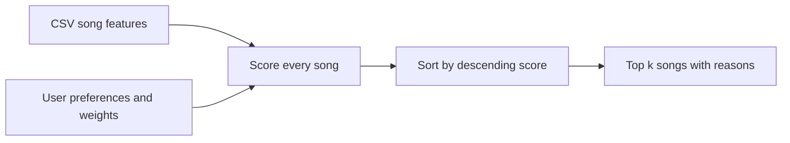

# Music Recommender Simulation: Vibe Compass

## Project Summary

Vibe Compass is a CLI-first, content-based music recommender for the CodePath AI110 project. It loads 18 synthetic songs, compares their attributes with a listening profile, and returns five ranked songs with an explanation of every score. It includes three contrasting profiles, two adversarial profiles, and a repeatable weight experiment. No model training, API key, or personal listening data is required.

## How The System Works

Real recommenders can use both behavior and item attributes. Collaborative filtering finds patterns across users' interactions, while content-based filtering compares item features with a user's preferences. YouTube describes watch/search history, subscriptions, likes, dislikes, and satisfaction feedback as recommendation signals. Music systems can also represent behavior such as skips and playlist additions alongside attributes such as tempo and mood. This classroom version only uses explicit preferences and song attributes; it does not reproduce a production platform's ranking system.

Sources: [Google's filtering overview](https://developers.google.com/machine-learning/recommendation/overview/candidate-generation), [content-based filtering](https://developers.google.com/machine-learning/recommendation/content-based/basics), and [YouTube recommendation signals](https://support.google.com/youtube/answer/16089387?hl=en).

### Data and profile design

- `Song` stores ID, title, artist, genre, mood, energy, tempo in BPM, valence, danceability, and acousticness. All numeric features except ID and tempo use a 0-to-1 scale.
- Ranking uses genre, mood, energy, and an optional acoustic preference. Tempo, valence, and danceability are retained for future work, not silently included in the score.
- `UserProfile` stores favorite genre, favorite mood, target energy, and whether the user likes acoustic music. The dictionary API accepts `genre`/`mood`/`energy` or the equivalent dataclass field names.
- The default dictionary is `{"genre": "pop", "mood": "happy", "energy": 0.8}`. Omitting `likes_acoustic` makes that feature neutral; `False` explicitly prefers less acoustic music.

Genre and mood give an understandable starting point, while energy distinguishes quiet and intense tracks within a style. Acousticness adds texture without overwhelming the main preferences. This profile separates intense rock from chill lofi, but one genre and one mood are too narrow to represent an entire person's taste. These are illustrative listening contexts, not claims about the author's preferences.

### Algorithm Recipe

```text
score = 2 * genre_match
      + 1 * mood_match
      + 1 * (1 - abs(song_energy - target_energy))
      + optional 0.5 * acoustic_similarity
```

Matching is case-insensitive and ignores surrounding spaces. Acoustic similarity is acousticness when the preference is true, or 1 minus acousticness when false. Energy similarity rewards closeness, not simply high energy: energy 0.3 and 0.7 are equally close to target 0.5. With validated inputs, scores range from 0 to 4, or 0 to 4.5 with acoustic preference. Scores are ranking points, not probabilities or accuracy percentages.

Scoring judges one song; ranking compares all the scores and selects the top k. `sorted()` produces a new list; `.sort()` changes a list in place and returns `None`. The implementation preserves the source catalog and uses stable sorting for equal scores. It ranks using full precision, so scores displayed to two decimals can appear tied even when their unrounded values differ slightly. Negative or noninteger k is rejected; zero returns no songs, and k larger than the catalog returns all available songs.



Expected bias: a genre match is worth more than a mood match, so an intense pop song can outrank a happy indie-pop song even for a happy listening context. Repeatedly reinforcing the favorite genre can create a filter bubble.

## Getting Started

Requires Python 3.10 or later. The application itself uses only the standard library.

```bash
python -m venv .venv
```

Activate with `.venv\Scripts\Activate.ps1` in PowerShell or `source .venv/bin/activate` on macOS/Linux, then run:

```bash
python -m pip install -r requirements.txt
python -m src.main
python -m src.main --profile all
python -m src.main --profile pop --experiment
python -m pytest -q
```

Run these commands from the repository root. Profiles: `pop`, `lofi`, `rock`, `conflicting`, and `unseen`. The CSV path is resolved from the source file, rather than the process's working directory.

## Sample Recommendation Output

The following is captured from `python -m src.main --profile all` and includes all three main profiles plus the two edge cases.

```text
Loaded songs: 18
Weights: genre=2.0, mood=1.0, energy=1.0, acoustic=0.5

Profile: pop {'genre': 'pop', 'mood': 'happy', 'energy': 0.8}
Top recommendations:
1. Sunrise City - Neon Echo | Score: 3.98
   Because: genre match (+2.00); mood match (+1.00); energy 0.82 vs target 0.80 (+0.98)
2. Gym Hero - Max Pulse | Score: 2.87
   Because: genre match (+2.00); mood mismatch (+0.00); energy 0.93 vs target 0.80 (+0.87)
3. Rooftop Lights - Indigo Parade | Score: 1.96
   Because: genre mismatch (+0.00); mood match (+1.00); energy 0.76 vs target 0.80 (+0.96)
4. City Resolve - Verse Atlas | Score: 0.95
   Because: genre mismatch (+0.00); mood mismatch (+0.00); energy 0.85 vs target 0.80 (+0.95)
5. Night Drive Loop - Neon Echo | Score: 0.95
   Because: genre mismatch (+0.00); mood mismatch (+0.00); energy 0.75 vs target 0.80 (+0.95)

Profile: lofi {'genre': 'lofi', 'mood': 'chill', 'energy': 0.35, 'likes_acoustic': True}
Top recommendations:
1. Library Rain - Paper Lanterns | Score: 4.43
   Because: genre match (+2.00); mood match (+1.00); energy 0.35 vs target 0.35 (+1.00); acoustic preference (+0.43)
2. Midnight Coding - LoRoom | Score: 4.29
   Because: genre match (+2.00); mood match (+1.00); energy 0.42 vs target 0.35 (+0.93); acoustic preference (+0.35)
3. Focus Flow - LoRoom | Score: 3.34
   Because: genre match (+2.00); mood mismatch (+0.00); energy 0.40 vs target 0.35 (+0.95); acoustic preference (+0.39)
4. Spacewalk Thoughts - Orbit Bloom | Score: 2.39
   Because: genre mismatch (+0.00); mood match (+1.00); energy 0.28 vs target 0.35 (+0.93); acoustic preference (+0.46)
5. Desert Letters - Copper Trail | Score: 1.44
   Because: genre mismatch (+0.00); mood mismatch (+0.00); energy 0.32 vs target 0.35 (+0.97); acoustic preference (+0.47)

Profile: rock {'genre': 'rock', 'mood': 'intense', 'energy': 0.9, 'likes_acoustic': False}
Top recommendations:
1. Storm Runner - Voltline | Score: 4.44
   Because: genre match (+2.00); mood match (+1.00); energy 0.91 vs target 0.90 (+0.99); non-acoustic preference (+0.45)
2. Gym Hero - Max Pulse | Score: 2.44
   Because: genre mismatch (+0.00); mood match (+1.00); energy 0.93 vs target 0.90 (+0.97); non-acoustic preference (+0.47)
3. Neon Footwork - Prism Circuit | Score: 1.43
   Because: genre mismatch (+0.00); mood mismatch (+0.00); energy 0.96 vs target 0.90 (+0.94); non-acoustic preference (+0.49)
4. Midnight Sparks - Ember Transit | Score: 1.41
   Because: genre mismatch (+0.00); mood mismatch (+0.00); energy 0.98 vs target 0.90 (+0.92); non-acoustic preference (+0.48)
5. City Resolve - Verse Atlas | Score: 1.39
   Because: genre mismatch (+0.00); mood mismatch (+0.00); energy 0.85 vs target 0.90 (+0.95); non-acoustic preference (+0.44)

Profile: conflicting {'genre': 'pop', 'mood': 'sad', 'energy': 0.95}
Top recommendations:
1. Gym Hero - Max Pulse | Score: 2.98
   Because: genre match (+2.00); mood mismatch (+0.00); energy 0.93 vs target 0.95 (+0.98)
2. Sunrise City - Neon Echo | Score: 2.87
   Because: genre match (+2.00); mood mismatch (+0.00); energy 0.82 vs target 0.95 (+0.87)
3. Blue Window - Velvet Current | Score: 1.53
   Because: genre mismatch (+0.00); mood match (+1.00); energy 0.48 vs target 0.95 (+0.53)
4. Neon Footwork - Prism Circuit | Score: 0.99
   Because: genre mismatch (+0.00); mood mismatch (+0.00); energy 0.96 vs target 0.95 (+0.99)
5. Midnight Sparks - Ember Transit | Score: 0.97
   Because: genre mismatch (+0.00); mood mismatch (+0.00); energy 0.98 vs target 0.95 (+0.97)

Profile: unseen {'genre': 'opera', 'mood': 'triumphant', 'energy': 0.5}
Top recommendations:
1. Blue Window - Velvet Current | Score: 0.98
   Because: genre mismatch (+0.00); mood mismatch (+0.00); energy 0.48 vs target 0.50 (+0.98)
2. Last Train Home - Juniper Roads | Score: 0.95
   Because: genre mismatch (+0.00); mood mismatch (+0.00); energy 0.55 vs target 0.50 (+0.95)
3. Sunday Courtyard - Golden Steps | Score: 0.92
   Because: genre mismatch (+0.00); mood mismatch (+0.00); energy 0.58 vs target 0.50 (+0.92)
4. Midnight Coding - LoRoom | Score: 0.92
   Because: genre mismatch (+0.00); mood mismatch (+0.00); energy 0.42 vs target 0.50 (+0.92)
5. Focus Flow - LoRoom | Score: 0.90
   Because: genre mismatch (+0.00); mood mismatch (+0.00); energy 0.40 vs target 0.50 (+0.90)
```

## Experiments You Tried

The `--experiment` option halves genre weight (2 to 1) and doubles energy weight (1 to 2), leaving mood and acoustic weights unchanged. This avoids editing the baseline between runs.

```text
Loaded songs: 18
Weights: genre=1.0, mood=1.0, energy=2.0, acoustic=0.5

Profile: pop {'genre': 'pop', 'mood': 'happy', 'energy': 0.8}
Top recommendations:
1. Sunrise City - Neon Echo | Score: 3.96
   Because: genre match (+1.00); mood match (+1.00); energy 0.82 vs target 0.80 (+1.96)
2. Rooftop Lights - Indigo Parade | Score: 2.92
   Because: genre mismatch (+0.00); mood match (+1.00); energy 0.76 vs target 0.80 (+1.92)
3. Gym Hero - Max Pulse | Score: 2.74
   Because: genre match (+1.00); mood mismatch (+0.00); energy 0.93 vs target 0.80 (+1.74)
4. City Resolve - Verse Atlas | Score: 1.90
   Because: genre mismatch (+0.00); mood mismatch (+0.00); energy 0.85 vs target 0.80 (+1.90)
5. Night Drive Loop - Neon Echo | Score: 1.90
   Because: genre mismatch (+0.00); mood mismatch (+0.00); energy 0.75 vs target 0.80 (+1.90)
```

For happy pop, Sunrise City stays first. Rooftop Lights moves from third (1.96) to second (2.92), and Gym Hero moves from second (2.87) to third (2.74). Rooftop Lights has the requested mood and closer energy, so the shift is consistent with emphasizing those attributes. The output is different; without listener ratings, this does not prove it is more accurate. The model card compares all profile pairs and discusses the edge cases.

## Limitations and Risks

The catalog contains invented metadata and only 18 songs. Genre matching treats pop and indie pop as unrelated. The model ignores lyrics, language, culture, listening history, and changing context. It always returns the best available songs even when none matches the requested genre or mood. It can repeat artists, and its fixed weights can reinforce a filter bubble. No ground-truth user ratings or listening study were collected.

## Reflection

This implementation demonstrates how a small set of features becomes a prediction through explicit design decisions. The happy-pop experiment shows that a recommendation can change without any song data changing: modifying the weights is enough. A numeric result is therefore evidence of the chosen rule, not proof of the listener's enjoyment.

The evaluation also shows how representation affects outcomes. Lofi has three catalog entries, while rock has one and opera has none. A wider catalog, feedback from listeners, and checks on diversity would be needed before making claims about quality or fairness. See the [model card](model_card.md) and the [honest AI assistance log](ai_interactions.md). The personal reflection in the model card is an AI-assisted draft for author review, not a record of human testing.
